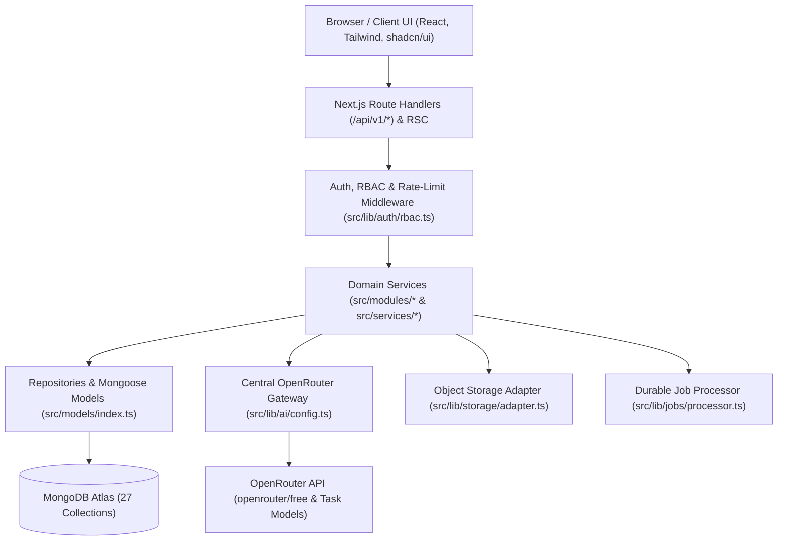

# LearnMate AI — System Architecture

## 1. High-Level Topology

LearnMate AI is a modular monolithic web application built on **Next.js App Router** (Node.js runtime) and **TypeScript**, persisted in **MongoDB Atlas** via **Mongoose**, and powered by **OpenRouter** for AI capabilities.

## 2. Finalized Module Boundaries

| Module (`src/modules/*`) | Owned Collections | Core Responsibilities |
| :--- | :--- | :--- |
| `auth` | `users` | Registration, sign-in/out, session cookies, password recovery, email verification, RBAC guards |
| `onboarding` | `users` | Country, education system/level, target exam, subjects, language, daily study minutes, learning style |
| `curriculum` | `educationSystems`, `educationLevels`, `examinations`, `subjects`, `chapters`, `topics` | 6-tier academic hierarchy browsing, personal saved topics, admin CRUD & JSON/CSV import-export |
| `tutor` | `conversations`, `messages` | Contextual subject/chapter/topic/document AI chat, streaming, Bangla/English & depth controls |
| `materials` | `generatedContents` | 12 AI material types generation, caching, personal study library CRUD, regeneration |
| `quizzes` | `quizzes`, `questions`, `quizAttempts` | Practice & mock exam generation, timed exams, objective auto-scoring, rubric AI short-answer grading |
| `flashcards` | `flashcardDecks`, `flashcards`, `reviewLogs` | Deck/card CRUD, AI flashcard generation, deterministic SM-2 spaced repetition & due queue |
| `planner` | `studyPlans`, `studyTasks` | Exam roadmap creation, deterministic date/hour scheduling, milestone & revision allocation, rescheduling |
| `documents` | `uploadedMaterials`, `documentChunks` | Validated PDF/TXT/DOCX upload, storage adapter, chunking, keyword/semantic RAG Q&A with page citations |
| `analytics` | `progressRecords` | Study time, quiz accuracy, topic mastery estimates, weak-topic detection, explainable recommendations |
| `notifications` | `notifications` | In-app study reminders, due flashcards, streaks, XP/badges, notification preferences |
| `admin` | `aiUsageLogs`, `promptTemplates`, `appSettings`, `feedbackReports`, `auditLogs` | Platform analytics, user/role management, AI task model & prompt management, content moderation, security audit logs |

## 3. Core Architectural Contracts Implemented in State 01

- **Domain Types & Enums**: [`src/types/domain.ts`](../src/types/domain.ts)
- **Standardized Error Hierarchy**: [`src/lib/api/errors.ts`](../src/lib/api/errors.ts)
- **Standardized Response & Pagination Envelopes**: [`src/lib/api/response.ts`](../src/lib/api/response.ts)
- **Authentication, RBAC & Ownership Isolation**: [`src/lib/auth/rbac.ts`](../src/lib/auth/rbac.ts)
- **OpenRouter Task Routing & Prompt-Injection Defense**: [`src/lib/ai/config.ts`](../src/lib/ai/config.ts)
- **Pluggable Storage & File Upload Validation**: [`src/lib/storage/adapter.ts`](../src/lib/storage/adapter.ts)
- **Durable Document Ingestion State Machine**: [`src/lib/jobs/processor.ts`](../src/lib/jobs/processor.ts)
- **27-Collection Schema & Index Registry**: [`src/lib/database/schema-registry.ts`](../src/lib/database/schema-registry.ts) & [`src/models/index.ts`](../src/models/index.ts)
