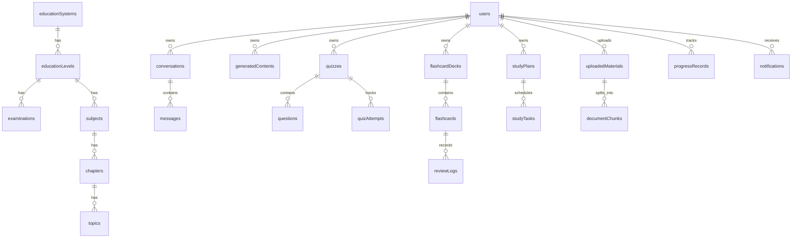

# LearnMate AI — Database Schema Specification

## 1. Authoritative Schema Registry

All 27 collections required by SRS Section 6.1 are codified in [`src/lib/database/schema-registry.ts`](../src/lib/database/schema-registry.ts) and exposed through [`src/models/index.ts`](../src/models/index.ts).

## 2. Entity Relationship Overview

## 3. Collection Specifications, Ownership & Indexes (27 Collections)

| # | Collection | Ownership Scope | Sensitive Fields (Excluded by Default) | Compound & Unique Indexes |
| :- | :--- | :--- | :--- | :--- |
| 1 | `users` | `user` (`_id`) | `passwordHash` | `email (unique)`, `(role, status, createdAt)`, `(educationSystemId, educationLevelId)` |
| 2 | `educationSystems` | `curriculum_cms` | — | `code (unique)`, `(country, isActive)` |
| 3 | `educationLevels` | `curriculum_cms` | — | `(educationSystemId, code) (unique)`, `(educationSystemId, isActive, order)` |
| 4 | `examinations` | `curriculum_cms` | — | `(educationLevelId, code) (unique)`, `(educationLevelId, isActive, examDate)` |
| 5 | `subjects` | `curriculum_cms` | — | `(educationLevelId, code) (unique)`, `(educationLevelId, isActive, order)`, `(examinationIds, isActive)` |
| 6 | `chapters` | `curriculum_cms` | — | `(subjectId, chapterNumber) (unique)`, `(subjectId, isActive, order)` |
| 7 | `topics` | `curriculum_cms` | — | `(chapterId, code) (unique)`, `(chapterId, isActive, order)`, `(subjectId, isActive, order)`, `text(title, description)` |
| 8 | `conversations` | `user` (`userId`) | — | `(userId, isArchived, updatedAt)`, `(userId, topicId, updatedAt)` |
| 9 | `messages` | `user` (`userId`) | — | `(conversationId, createdAt)`, `(userId, createdAt)` |
| 10 | `generatedContents` | `user` (`userId`) | — | `(userId, isSavedToLibrary, materialType, createdAt)`, `(userId, topicId, materialType)`, `cacheKey (sparse)` |
| 11 | `quizzes` | `user` (`userId`) | — | `(userId, mode, createdAt)`, `(userId, subjectId, createdAt)` |
| 12 | `questions` | `parent_quiz` (`userId`) | `correctOptionIds`, `expectedShortAnswerRubric`, `explanation` | `(quizId, order) (unique)`, `(userId, topicId)` |
| 13 | `quizAttempts` | `user` (`userId`) | — | `(userId, quizId, createdAt)`, `(userId, status, submittedAt)` |
| 14 | `flashcardDecks` | `user` (`userId`) | — | `(userId, updatedAt)`, `(userId, subjectId, topicId)` |
| 15 | `flashcards` | `user` (`userId`) | — | `(userId, nextReviewAt)`, `(deckId, userId, createdAt)`, `(userId, masteryState, nextReviewAt)` |
| 16 | `reviewLogs` | `user` (`userId`) | — | `(userId, reviewedAt)`, `(flashcardId, reviewedAt)` |
| 17 | `studyPlans` | `user` (`userId`) | — | `(userId, status, targetDate)` |
| 18 | `studyTasks` | `user` (`userId`) | — | `(userId, studyPlanId, scheduledDate, priorityRank)`, `(userId, status, scheduledDate)` |
| 19 | `uploadedMaterials` | `user` (`userId`) | — | `(userId, processingStatus, createdAt)`, `(processingStatus, updatedAt)` |
| 20 | `documentChunks` | `user` (`userId`) | — | `(userId, materialId, chunkIndex) (unique)`, `text(content)` |
| 21 | `progressRecords` | `user` (`userId`) | — | `(userId, topicId) (unique)`, `(userId, subjectId, estimatedMasteryScore)` |
| 22 | `notifications` | `user` (`userId`) | — | `(userId, isRead, createdAt)`, `(userId, dedupeKey) (sparse)` |
| 23 | `aiUsageLogs` | `admin_system` (`userId`) | — | `(userId, createdAt)`, `(taskType, modelId, status, createdAt)` |
| 24 | `promptTemplates` | `admin_system` | — | `(taskType, version) (unique)`, `(taskType, isActive)` |
| 25 | `appSettings` | `admin_system` | — | `key (unique)` |
| 26 | `feedbackReports` | `user` (`userId`) | — | `(status, createdAt)`, `(userId, createdAt)` |
| 27 | `auditLogs` | `admin_system` | — | `(actorId, createdAt)`, `(action, createdAt)` |

## 4. Data Integrity & Security Rules

1. **Ownership Isolation**: Every student-owned collection requires `userId` (`ObjectId` referencing `users`) and is queried through `assertResourceOwnership()` or `{ userId: actor.userId }` filters.
2. **Assessment Security**: `questions.correctOptionIds`, `questions.expectedShortAnswerRubric`, and `questions.explanation` are marked `sensitive: true` and stripped when serving active examination questions prior to submission.
3. **No Binary Storage in MongoDB**: Uploaded files are stored via `StorageAdapter`; `uploadedMaterials` stores only metadata and `storageKey`, while extracted text segments live in `documentChunks`.
