# LearnMate AI — Phased Remediation & Production Readiness Plan

**Baseline:** SRS States 00–12 Complete (`d83eee5`) · **Target:** Complete Remediation (`Phases 01–09`) followed by **Original SRS State 13 (Deployment & Production Readiness)**.  
**Execution Rule:** One phase per user invocation (`Continue from Context.md`), strict dependency order, zero data loss, zero mock-only production shortcuts, Vitest/lint/typecheck gates required at every phase boundary.

---

## 1. Dependency Roadmap

```mermaid
flowchart LR
    P00["Phase 00: Audit & Plan (Done)"] --> P01["Phase 01: Custom Education Data & APIs"]
    P01 --> P02["Phase 02: Nav, Notifications & Global Sonner UI"]
    P02 --> P03["Phase 03: Shared AI Harness & Durable Worker"]
    P03 --> P04["Phase 04: AI Tutor, AI Elements & Web Search"]
    P04 --> P05["Phase 05: Study Materials Studio"]
    P05 --> P06["Phase 06: Flashcards Redesign"]
    P06 --> P07["Phase 07: Study Planner Wizard"]
    P07 --> P08["Phase 08: Vercel Blob & Durable RAG"]
    P08 --> P09["Phase 09: Full QA, E2E & Responsive Audit"]
    P09 --> S13["State 13: Production Deployment Readiness"]
```

---

## 2. External Credentials & User Decisions Required Ahead of Later Phases

| Needed Before | Item | Options / Requirement | Impact if Deferred |
|---|---|---|---|
| **Phase 04** | Web Search Provider API Key | **Tavily Search (`TAVILY_API_KEY`)** *(recommended for academic/RAG answers)* or **Brave Search (`BRAVE_SEARCH_API_KEY`)** | Web Search adapter builds cleanly & tests via mock transport; live search cleanly reports "Web search unavailable (provider key not configured)" rather than faking results. |
| **Phase 08** | Object Storage Token | **`BLOB_READ_WRITE_TOKEN`** from Vercel Blob store (`@vercel/blob`) | Local/test storage adapter continues passing automated tests; live Vercel preview upload test requires Blob token. |
| **Phase 08** | Semantic Embeddings (Optional) | Dedicated OpenAI / OpenAI-compatible / OpenRouter embedding key + `AI_EMBEDDING_MODEL` + MongoDB `ATLAS_VECTOR_INDEX_NAME` | RAG works reliably in `'keyword'` fallback mode with honest reporting until vector credentials + Atlas index exist. |
| **Phase 08 / State 13** | Vercel Project Link | Vercel preview deployment connected to GitHub repo & Atlas cluster | Local/Vitest/Playwright verification passes; Phase 08 explicitly requires live Vercel preview document test before closing RAG verification. |

---

## 3. Detailed Phase Execution Specifications

---

### Phase 01 — Custom Education System and Data Architecture

**Objective:** Enable both verified admin-managed **Standard Education Systems** and full student-owned **Custom Education Systems**, customizable **Education Labels** (UI terminology decoupled from entity data), flexible **Custom Hierarchies**, **Custom Examinations**, and **Custom Subjects/Chapters/Topics** across all backend models, APIs, and onboarding.

- **Schema & Database Changes (`src/lib/database/schema-registry.ts`, `src/types/domain.ts`, `src/models/index.ts`)**:
  - Add `scope: 'global' | 'custom'` (default `'global'`), `ownerUserId?: ObjectId` (`ref: 'users'`), and `isArchived: Boolean` (default `false`) to `educationSystems`, `educationLevels`, `examinations`, `subjects`, `chapters`, `topics`.
  - Add custom education system fields to `educationSystems`: `educationType` (`standard | school | university | competitive | certification | self_learning | custom`), `preferredLanguage`, `academicYear`, `hierarchyLevels` (validated array of `{ key, singularLabel, pluralLabel, order, required, allowMultiple }`), and optional embedded default `labelMap`.
  - Add **`educationLabelConfigs` collection** (collection #28, `ownershipScope: 'user'`) storing per-user / per-system terminology overrides (`systemLabel`, `levelLabel`, `yearLabel`, `semesterLabel`, `examinationLabel`, `subjectLabel`, `chapterLabel`, `topicLabel`, each with `{ singular, plural, required, allowMultiple, order, isVisible }`), completely isolated from underlying entity titles/foreign keys.
  - Extend `examinations` with: `syllabusCoverage` (text + optional `topicIds`), `totalMarks`, `durationMinutes`, `preparationGoals`, `topicPriorities` (`[{ topicId, priority }]`), and allow optional `educationLevelId` when custom hierarchy omits `level`.
  - Extend `subjects` with: `color`, `icon`, `difficultyLevel`, `learningObjectives` (`string[]`), and allow optional `educationLevelId` for custom hierarchies.
  - Replace rigid unique indexes (e.g., `educationSystems.code`, `subjects.{educationLevelId, code}`) with owner-scoped composite uniqueness (`{ scope: 1, ownerUserId: 1, code: 1 }`) so user records never collide with global seed data or other users.
- **Backward-Compatible Data Migration (`scripts/migrate-custom-education.ts`)**:
  - Idempotent migration/backfill setting `scope: 'global'` and `isArchived: false` on all existing seeded records and syncing updated Mongoose indexes safely without dropping or mutating existing user accounts (`users.educationSystemId`, `selectedSubjectIds`, `savedTopicIds`, quizzes, flashcards, materials, plans).
- **APIs & Services**:
  - Create `src/modules/curriculum/custom-education-service.ts` + validators `src/lib/validators/custom-education.ts`.
  - Add endpoints:
    - `GET/POST /api/v1/education/systems` and `PATCH/DELETE /api/v1/education/systems/[systemId]` (create, edit, archive, safe delete checks/cascading archive).
    - `GET/PUT /api/v1/education/labels` (get active resolved labels, update/reset custom label definitions + preview metadata).
    - `GET/POST /api/v1/education/examinations` and `PATCH/DELETE /api/v1/education/examinations/[examId]` (create, edit, duplicate, archive, delete).
    - `GET/POST /api/v1/education/subjects` and `PATCH/DELETE /api/v1/education/subjects/[subjectId]` (create/manage custom subjects + nested chapter & topic CRUD routes `/api/v1/education/chapters`, `/api/v1/education/topics`).
  - Update `browseCurriculumHierarchy` in `curriculum-service.ts` and `curriculum-repository.ts` to merge `scope: 'global'` records with `scope: 'custom' && ownerUserId === verified.userId` records and return resolved `labels` for UI consumption.
  - Update `/api/v1/onboarding` and `src/app/(student)/onboarding/page.tsx` so students can select a Standard System **or** start a Custom Education System directly, and custom subject names typed during onboarding create real linked `subjects` documents (`scope: 'custom'`) instead of orphan strings.
- **UI**: Add dedicated Custom Education Setup & Label Manager UI (`/settings/education` or integrated tab/workspace under `/my-learning` + onboarding flow) with live hierarchy preview.
- **Verification**: `tests/phase-01-custom-education.test.ts` testing global preservation, custom system/label/hierarchy/exam/subject/chapter/topic CRUD, ownership isolation (User B blocked from User A custom records), label rename non-mutation invariant, idempotent migration script, and all prior 47 unit tests passing.

---

### Phase 02 — Academic Navigation, Notifications Redesign & Global UI/Sonner System

**Objective:** Install missing shadcn/ui primitives & `Sonner`, overhaul persistent Notifications into a clean SaaS Notification Center, simplify Academic/Chapter Navigation (removing the 6-dropdown grid), and establish unified toast/dialog/alert feedback patterns across existing pages.

- **shadcn/ui CLI & Global Feedback Layer**:
  - Run shadcn CLI to install: `sonner`, `alert`, `alert-dialog`, `dialog`, `sheet`, `select`, `switch`, `progress`, `dropdown-menu`, `hover-card`, `collapsible`, `scroll-area`, `textarea`, `label`, `checkbox`, `slider`.
  - Mount `<Toaster richColors closeButton />` inside `src/components/providers/app-providers.tsx` using `next-themes`.
  - Create `src/lib/ui/toast.ts` (`notifySuccess`, `notifyError`, `notifyWarning`, `notifyInfo`, `notifyPromise`, automatic dedupe IDs, error sanitization) and shared `<ConfirmDialog>` helper wrapping `AlertDialog`.
  - Replace browser alerts or misleading inline feedback across Settings/Auth/Curriculum/Notifications with the standardized shadcn component mapping (`Sonner` for transient results, `Alert` for persistent warnings, `AlertDialog` for destructive confirms).
- **Notifications System Overhaul**:
  - Extend `NOTIFICATION_TYPES` (`types/domain.ts`, `schema-registry.ts`): add `quiz_result`, `ai_generation`, `document_processing`, `system` alongside existing types (`study_reminder`, `upcoming_revision`, `due_flashcards`, `upcoming_exam`, `missed_task`, `learning_milestone`), keeping existing notification docs valid.
  - Update `AnalyticsRepository` + `analytics-service.ts` + `src/app/api/v1/notifications/route.ts`: support `status` (`all | unread | read`), `category` (`all | study | quiz_exam | flashcards | ai_documents | system`), `page` & `limit` pagination, `DELETE` (dismiss single or clear read), and `PATCH` (`mark_read`, `mark_all_read`, `update_preferences` for expanded categories).
  - Redesign `src/app/(student)/notifications/page.tsx`: clean SaaS Notification Center header (Unread badge, Mark All Read, Preferences `Sheet`/`Dialog` button instead of permanent top card), filter tabs + category chips, notification rows with category icon, title, concise description, relative + tooltip timestamps, unread indicator, action button (`Link` to `/flashcards`, `/planner`, `/documents`, `/quizzes`, etc.), dismiss button, and Load More / pagination controls.
- **Academic & Chapter Navigation Redesign**:
  - Replace the 6-column `<select>` bar in `src/app/(student)/my-learning/page.tsx` with a progressive Academic Workspace:
    - **Context Breadcrumb Header**: Shows active System → Exam → Subject → Chapter using **dynamic custom education labels** from Phase 01 + a **"Change System / Exam"** `Dialog`/`Sheet` + **"Manage Custom Education"** shortcut.
    - **Subject Overview Grid**: Displays student's standard + custom subjects with color/icon badges, topic completion progress (`Progress`), and quick open.
    - **Dedicated Subject & Chapter Workspace** (`/my-learning` interactive view + optional `/my-learning/[subjectId]` route sharing cleanly): Collapsible desktop Chapter Navigation Sidebar & mobile `Sheet` Drawer listing chapters with topic counts and completion badges; main panel displays Chapter title, objectives, ordered Topic cards (completion toggle, difficulty badge, study minutes, direct "Open in AI Tutor / Quiz / Materials / Flashcards"), and **Previous / Next Chapter** buttons.
- **Verification**: `tests/phase-02-notifications-nav.test.ts` + responsive check (`375px`, `768px`, `1280px`) + `typecheck` + `lint` + full Vitest suite.

---

### Phase 03 — Centralized Agentic AI Harness and Durable Worker Infrastructure

**Objective:** Build the unified server-side Agentic AI Harness (`AIHarnessManager`, `TaskRouter`, capability-aware `ModelRouter`, `ToolRegistry`, `PromptRegistry`, persisted `userHarnessSettings`, and durable MongoDB `aiJobs` execution engine) and wire all AI endpoints into it.

- **Database Schemas (`src/lib/database/schema-registry.ts`, `src/models/index.ts`)**:
  - **`userHarnessSettings`** (`ownershipScope: 'user'`): stores user defaults & customization (`mode`: `general_tutor | exam_prep | concept_explainer | research_assistant | problem_solver | document_assistant`, `customInstructions`, `preferredLanguage`, `explanationDepth`, `responseFormat`: `structured | concise | socratic | step_by_step`, `preferredModelId`, `enableWebSearch`, `useUploadedDocs`, `citationStyle`: `inline | footnotes | none`, optional default `subjectId` & `learningObjectives`).
  - **`aiJobs`** (`ownershipScope: 'user'`): durable job record (`jobType`: `material_generation | quiz_generation | flashcard_generation | planner_advice | document_ingestion | research_answer`, `status`: `pending | processing | completed | failed | retry_scheduled | cancelled`, `progressPercent`, `currentStageLabel`, `inputPayload`, `resultPayload`, `errorMessage`, `attemptCount`, `maxAttempts`, `nextRetryAt`, `startedAt`, `completedAt`, `workerLockUntil`).
  - Extend `aiUsageLogs` with `toolsInvoked` (`string[]`) and `jobId` (`ObjectId`).
- **Core Harness Modules (`src/modules/ai/harness/`)**:
  - `model-router.ts`: Catalogs OpenRouter model capabilities (`supportsTools`, `supportsStructuredOutput`, `supportsStreaming`, `maxOutputTokens`, `contextTokens`), merges admin `AIPlatformConfig` allowlists, and builds safe fallback chains.
  - `task-router.ts`: Maps every `AITaskType` + `document_ingestion` to approved tool allowlists, default temperatures/token limits, validation policies, and streaming capability.
  - `tool-registry.ts`: Registers typed, Zod-validated server tools (`lookup_curriculum`, `lookup_topic_detail`, `search_uploaded_documents`, `study_plan_context`, plus stubs/hooks for `web_search` & `fetch_webpage` completed in Phase 04), each emitting sanitized human-readable activity metadata (`phaseLabel`, `status`, `summary`, zero raw CoT or secrets).
  - `harness-manager.ts`: Loads `userHarnessSettings` + admin `AIPlatformConfig` (always enforcing admin security rules, tool allowlists, and rate/token limits over user overrides), resolves `PromptRegistry` template, runs bounded tool-use + OpenRouter orchestration (`executeHarnessText`, `executeHarnessStructured`, `streamHarnessChat`), and persists telemetry.
  - `job-worker.ts`: Idempotent MongoDB-backed step processor (`enqueueJob`, `claimAndProcessJob`, `processDueJobs`, `cancelJob`, `retryJob`) using atomic `findOneAndUpdate` locking — zero permanent in-memory worker threads. Expose `/api/v1/jobs`, `/api/v1/jobs/[jobId]` (polling/cancel), and `/api/v1/jobs/process` (authenticated user/cron trigger).
  - API `/api/v1/ai/harness-settings` (`GET`, `PUT`) for reading and persisting user customization + permitted model options.
- **Refactor Existing AI Callers**: Migrate `quiz-service.ts`, `flashcard-service.ts`, `planner-service.ts`, `analytics-service.ts` recommendations, `tutor-materials-service.ts`, and `document-service.ts` Q&A onto `AIHarnessManager`.
- **Verification**: `tests/phase-03-ai-harness.test.ts` testing task routing, capability fallback when structured/tools unsupported, user preference persistence, security enforcement (user override blocked from bypassing admin allowlist or quota), tool registry scoping, and durable `aiJobs` state transitions & idempotency.

---

### Phase 04 — AI Tutor with Web Search, Citations & shadcn AI Elements

**Objective:** Upgrade AI Tutor into a research-capable conversational workspace powered by the Phase 03 AI Harness, external Web Search + SSRF-safe Webpage Fetcher, verifiable citations, and modular **shadcn AI Elements**.

- **Web Search & SSRF-Safe Webpage Fetcher (`src/modules/ai/web-search/`)**:
  - `search-adapter.ts`: Provider-independent `WebSearchAdapter` interface + implementations for **Tavily** (`TAVILY_API_KEY`) and **Brave Search** (`BRAVE_SEARCH_API_KEY`), with clean normalized output (`{ title, url, publisher, snippet, publishedAt?, retrievedAt }`), configurable result limit & timeout, and explicit unconfigured-provider error handling (`WebSearchUnavailableError` without fabricating results).
  - `safe-fetcher.ts`: Strict SSRF guard: validate `http:`/`https:` scheme, resolve DNS (`dns/promises` `lookup`) and block all loopback (`127.0.0.0/8`, `::1`), private (`10.0.0.0/8`, `172.16.0.0/12`, `192.168.0.0/16`, `fc00::/7`), link-local/cloud metadata (`169.254.0.0/16`, `fe80::/10`), multicast/unspecified IPs; follow redirects manually (max 3 hops) re-validating every target host/IP; enforce 8s timeout & 1.5 MB byte limit; strip `<script>`, `<style>`, `<noscript>` and extract readable text wrapped as `<untrusted_web_source url="..." retrieved_at="...">`.
- **Tutor Service & Schema Updates**:
  - Extend `messages.sourceReferences` structure cleanly to store verifiable citations (`{ id, sourceType: 'curriculum' | 'document' | 'web_search' | 'web_inspected', title, publisher?, url?, locator?, excerpt?, publishedAt?, retrievedAt, retrievalStatus: 'verified' | 'snippet_only' | 'unavailable' }`) plus optional `toolActivitySummary` (`[{ toolName, label, status, summary }]`).
  - Implement research-capable SSE event stream in `/api/v1/tutor/conversations/[conversationId]/messages`: streams phase events (`phase` -> `tool` -> `sources` -> `delta` -> `done`), supports smart search necessity heuristic + explicit user web-search toggle, respects uploaded-document grounding toggle, saves verified citations on assistant message, and rejects fabricated URLs via validation against actual tool outputs of that turn.
- **shadcn AI Elements (`src/components/ai-elements/`)**:
  - Implement reusable components over installed shadcn primitives: `chat.tsx`, `message.tsx`, `message-scroller.tsx`, `prompt-input.tsx`, `tool.tsx` / `trace.tsx`, `sources.tsx`, `inline-citation.tsx`, `model-selector.tsx`, `confirmation.tsx`.
  - Refactor `src/app/(student)/tutor/page.tsx` cleanly into modular client components using AI Elements: streaming Markdown/code/math display, clickable `[1]` inline citations opening `HoverCard` + `Sources` sheet/panel, expandable Tool Activity cards, Stop Generation (`AbortController`), Regenerate response, Copy, Feedback (`helpful | unhelpful | flagged`), Custom/Standard curriculum & Uploaded Document context selector, and **Customize AI Harness `Sheet`** (6 preset modes, instructions, language, depth, format, search/doc/citation toggles, permitted model selector, Advanced collapsible section).
- **Verification**: `tests/phase-04-tutor-web-search.test.ts` testing SSRF IP/redirect/protocol blocks, untrusted HTML sanitization, citation integrity (only tool-returned URLs allowed), graceful handling of search provider timeouts/missing keys, conversation/custom-subject grounding, and AI Harness integration.

---

### Phase 05 — Study Materials Redesign & Shared AI Harness Integration

**Objective:** Evolve `/materials` into a customizable workspace with templates, favorites, multi-source selection, guided wizard creation, section-level regeneration, duplication, export/print, and AI Harness execution.

- **Schema & Service (`schema-registry.ts`, `tutor-materials-service.ts`)**:
  - Extend `generatedContents` cleanly with: `isFavorite`, `templateId`, `sourceRefs` (`topicIds`, `uploadedMaterialIds`, `savedMaterialIds`, `customInstructions`), `generationOptions` (`detailLevel`, `length`, `formattingStyle`, `examFocus`, `includeExamples`, `sourceRestriction`, `requireCitations`), and `customTopicTitle`. Keep backward compatibility with existing saved records.
  - Add `/api/v1/materials/[materialId]/regenerate-section`, `/api/v1/materials/[materialId]/duplicate`, `isFavorite` toggle in `PATCH`, and built-in + custom `MaterialTemplates` catalog (`GET /api/v1/materials/templates`).
  - Route generation and section regeneration exclusively through **Phase 03 `AIHarnessManager`** (`materials` profile, optional RAG doc lookup + web citations when enabled), emitting durable job status when run asynchronously or streaming/progress feedback.
- **UI Redesign (`src/app/(student)/materials/page.tsx` + feature components)**:
  - Workspace Tabs: `My Materials`, `Create New Material`, `Saved Materials`, `Recently Generated`, `Material Templates`, `Favorite Materials`.
  - Search, sort, subject (standard + custom), and topic filters.
  - Guided Multi-Step Creation Flow: 1. Multi-source selector (System/Exam/Subject/Chapter/Topic + Uploaded Docs + Saved Materials + Custom Prompt) -> 2. 12 Material Types & Templates -> 3. Customize Generation (sensible defaults + collapsible Advanced section) -> 4. Harness progress display (`understanding -> retrieving -> generating -> validating -> saved`) -> 5. Interactive Reader/Editor (inline edit, regenerate all, regenerate selected section, change formatting, favorite, duplicate, Markdown download, Print).
- **Verification**: `tests/phase-05-materials.test.ts` verifying multi-source harness generation, favorites/templates/duplication/section-regeneration persistence, ownership checks, and `typecheck`/`lint`.

---

### Phase 06 — Flashcards Redesign

**Objective:** Transform `/flashcards` into a clean, responsive spaced-repetition experience with a Start Reviewing dashboard, deck collections & duplication, 3D flip stage (`prefers-reduced-motion` aware), keyboard controls, real view-duration tracking, and AI Harness generation.

- **Service & Data Updates (`flashcard-service.ts`, `flashcard-repository.ts`, `schema-registry.ts`)**:
  - Add optional `collectionName` and `isArchived` to `flashcardDecks`; preserve all existing decks & SM-2 fields.
  - Add `POST /api/v1/flashcards/[id]` duplicate deck action (alongside deck edit/delete & card CRUD), verify custom subject/topic support, and route AI deck generation through `AIHarnessManager` (`flashcards` profile).
- **UI Redesign (`src/app/(student)/flashcards/page.tsx` + components)**:
  - Overview Dashboard: Today's Review summary, Due count, Total cards, Mastery ring/bar, Deck Collections & Recent Review Logs, prominent **Start Reviewing** CTA.
  - Deck Management Grid: Search, subject/collection filters, deck cards with mastery estimate, due count, last review timestamp, Edit, Duplicate, and `AlertDialog`-confirmed Delete.
  - Interactive 3D Flip Review Stage: Large card canvas with smooth 3D CSS flip (instantly switches cleanly when `prefers-reduced-motion: reduce`), progress bar & card counter, keyboard shortcuts (`Space` flip, `1` Again / `2` Hard / `3` Good / `4` Easy, `H` hint), mobile swipe/tap controls, **measured card view duration** (`Date.now() - cardShownAt` replacing hardcoded `4200`), and visible SM-2 next-interval preview labels on rating buttons.
- **Verification**: `tests/phase-06-flashcards.test.ts` verifying SM-2 determinism preservation, deck duplication & confirmed delete, real duration tracking payload, custom subject deck generation via AI Harness, and full test suite pass.

---

### Phase 07 — Study Planner Redesign

**Objective:** Replace the dense Study Planner setup form with a 5-step Guided Creation Wizard and a clear Today/Weekly/Roadmap/Timeline dashboard supporting custom examinations, custom subjects, and reliable deterministic scheduling via the AI Harness.

- **Service & Engine Updates (`planner-service.ts`, `scheduler-engine.ts`, `schema-registry.ts`)**:
  - Extend `studyPlans` cleanly with optional `goalType` (`standard_exam | custom_exam | personal_goal`), `revisionPreference`, `dailySessionCount`, `commitments` (blocked dates/minutes), and `chapterIds` coverage while maintaining existing plan documents cleanly.
  - Keep deterministic time-budgeting and feasibility validation strict (never exceed `dailyStudyMinutes` minus commitments, preserve completed task history on recalculate/reschedule, keep `FR-PLAN-011` honest weighting guard).
  - Route AI plan recommendations through `AIHarnessManager` (`planner` profile).
- **UI Redesign (`src/app/(student)/planner/page.tsx` + components)**:
  - **5-Step Guided Creation Wizard**: 1. Goal / Existing Exam / Custom Exam / Personal Goal -> 2. Subjects & Syllabus Coverage -> 3. Availability & Commitments -> 4. Learning & Revision Preferences -> 5. Preview Feasibility & Generate Plan.
  - **Tabbed Dashboard**: Summary metrics (Today's Focus, Exam Countdown, Missed Tasks banner with 1-click Smart Reschedule) + `Tabs` (`Today & Tasks`, `Weekly Calendar`, `Subject Roadmap`, `Timeline`), plus clean `Dialog` for Add/Edit Task (title, duration, priority, date, skip/complete).
- **Verification**: `tests/phase-07-planner.test.ts` covering custom exam + custom subject plan generation, capacity impossibility rejection/warning, missed task rescheduling preserving completed tasks, task CRUD, and harness invocation.

---

### Phase 08 — Complete RAG System Rework for Vercel Production Compatibility

**Objective:** Rebuild file upload, storage, binary extraction, fingerprinting, embeddings, Atlas Vector/Hybrid retrieval, and durable MongoDB job processing so PDF/DOCX/TXT RAG works end-to-end both locally and in a real Vercel deployment.

- **Dependencies & Configuration**:
  - Install `@vercel/blob`, binary PDF parser (verified Node serverless compatible, e.g., `unpdf` or `pdf-parse`), and binary DOCX parser (`mammoth` or lightweight ZIP XML reader `jszip`), keeping `next.config.mjs` `serverExternalPackages` clean if needed.
  - Align embedding env vars across `.env.example`, `docs/DEPLOYMENT.md`, and `src/modules/documents/rag-engine.ts` (`AI_EMBEDDING_PROVIDER`, `AI_EMBEDDING_MODEL`, `AI_EMBEDDING_API_KEY`, `ATLAS_VECTOR_INDEX_NAME`).
- **Storage & Direct Client Upload (`src/lib/storage/adapter.ts`, `/api/v1/documents/upload-token`, `/api/v1/documents`)**:
  - Implement concrete `VercelBlobStorageAdapter` using `@vercel/blob` (`put`, `del`, fetch via signed/private/blob URL) alongside `LocalDiskOrMemoryStorageAdapter` for local dev without Blob token (explicitly logged) and automated tests.
  - Add authenticated `/api/v1/documents/upload-token` (`handleUpload` from `@vercel/blob/client`) validating user session, `ALLOWED_UPLOAD_MIME_TYPES`, `MAX_UPLOAD_BYTES` (15 MB), and scoping pathname under `users/${userId}/docs/` — eliminating the 4.5 MB Vercel request body limit.
  - Update `src/app/(student)/documents/page.tsx` to stream binary files directly to Vercel Blob via `@vercel/blob/client` (falling back to authenticated multipart binary `FormData` upload route in local dev when `BLOB_READ_WRITE_TOKEN` is unset — **never** calling `file.text()` on PDF/DOCX!).
- **Binary Extraction, Fingerprinting & Durable Ingestion (`rag-engine.ts`, `document-service.ts`, `aiJobs`)**:
  - Implement `extractReadableTextFromBuffer(format, buffer)`: parse genuine binary PDF pages & headings, real ZIP-compressed `.docx` paragraphs/headings, and normalized UTF-8 `.txt`, explicitly failing cleanly on encrypted, empty, or corrupted files.
  - Compute SHA-256 `contentSha256` fingerprint on `uploadedMaterials`; warn/deduplicate repeat uploads per user cleanly.
  - Enqueue durable `aiJobs` document ingestion record -> process idempotent stages (`extracting -> chunking -> embedding -> indexing -> ready | failed | retry_scheduled`) via `/api/v1/jobs/process` + Vercel Cron (`vercel.json` or triggered step runner) with live `Progress` bar + `Sonner` toast on completion/retry/error.
  - Implement `EmbeddingProviderAdapter` + real MongoDB Atlas `$vectorSearch` pipeline in `MongooseDocumentRepository` when embeddings + `ATLAS_VECTOR_INDEX_NAME` are active, falling back transparently to `'keyword'` mode with honest UI badge (`Semantic Vector Search Active` vs `Keyword Retrieval Mode`).
- **RAG Grounded AI Integration**:
  - Connect multi-document & custom-subject/chapter/topic filtering into `document_qa` and AI Tutor / Materials via `AIHarnessManager`, strictly isolating queries by `userId` and keeping `<untrusted_document_chunk>` sandboxing intact.
- **Deployment Testing**:
  - Unit & integration test suite `tests/phase-08-rag-vercel.test.ts` testing real binary PDF & DOCX buffer extraction, duplicate SHA-256 detection, durable job state retries, cross-user chunk isolation, honest embedding fallback, and Blob delete cleanup.
  - Execute live Vercel preview verification protocol (upload real PDF/DOCX/TXT -> check Blob & MongoDB chunks -> Q&A citations -> failure retry -> deletion cleanup).

---

### Phase 09 — Complete Integration, QA, Security Review, Playwright E2E & Responsive Verification

**Objective:** Verify the entire remediated platform across all modules, run Playwright end-to-end journeys across mobile & desktop viewports, conduct a full security & database index audit, and finalize documentation before State 13 deployment.

- **Security & Architecture Audit**:
  - Verify server-side auth & RBAC across all new/modified routes (custom education, notifications, AI harness settings, jobs, web search, Blob upload tokens).
  - Verify SSRF defenses, prompt injection sandboxing, rate limiting, secret non-exposure (`scripts/lint.mjs`), and absence of mock-only production fallbacks.
  - Verify MongoDB indexes match every new query pattern across modified & new collections (`SCHEMA_REGISTRY` audit tests).
- **Automated Testing**:
  - Run full Vitest suite (`state-01`..`12` + `phase-01`..`08` + new `tests/phase-09-integration-security.test.ts`).
  - Expand and execute Playwright E2E suite (`tests/e2e/critical-journeys.spec.ts`) covering mobile (`375x812`) & desktop (`1280x800`): onboarding/custom education -> my-learning chapter navigation -> notifications -> AI Tutor + citations -> Study Materials wizard -> Flashcards 3D review -> Study Planner wizard -> Document upload & Q&A.
  - Run `npm run typecheck`, `npm run lint`, and `npm run build` with 0 errors.
- **Documentation Updates**: Update `docs/ARCHITECTURE.md`, `docs/DATABASE_SCHEMA.md`, `docs/API_SPECIFICATION.md`, `docs/AI_INTEGRATION.md`, and `docs/TESTING_STRATEGY.md` cleanly to reflect the final architecture.

---

### State 13 — Deployment and Production Readiness (Queued After Phase 09)

Once **Phases 01–09** pass acceptance gates, resume the original SRS final gate:
- Finalize `vercel.json` (Cron schedule for durable `aiJobs` recovery, headers, function memory/maxDuration config), `scripts/seed.ts` + `scripts/migrate-custom-education.ts` verification against MongoDB Atlas, `/api/v1/health` readiness checks (MongoDB + OpenRouter + Blob + Web Search status without secret leakage), `docs/DEPLOYMENT.md` production runbook, and production smoke verification.
